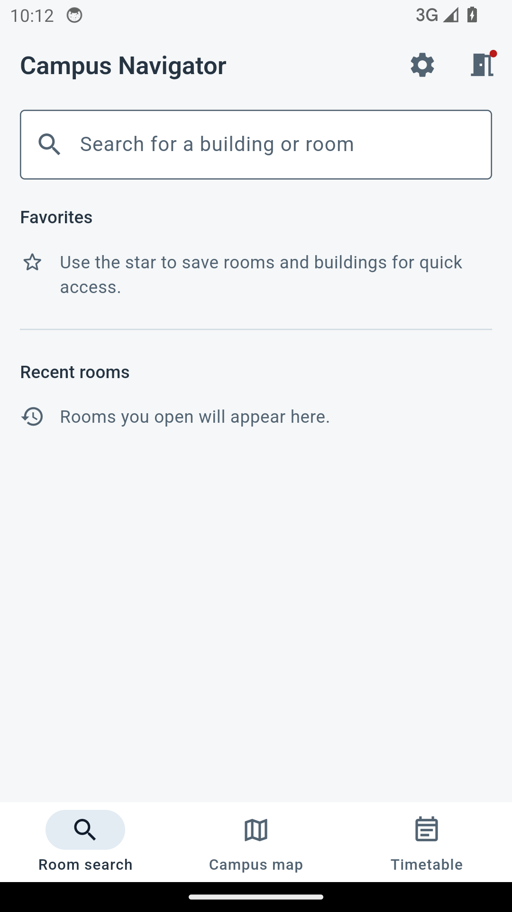
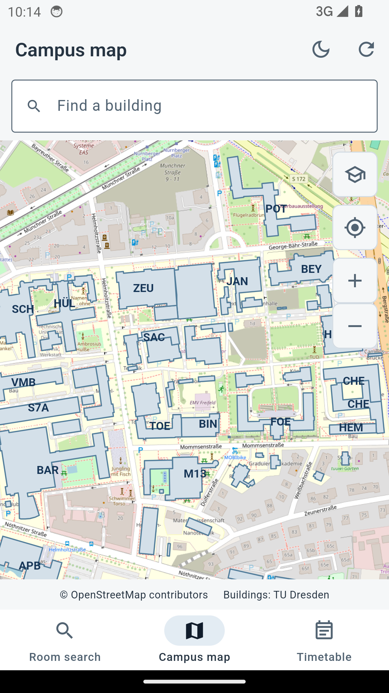
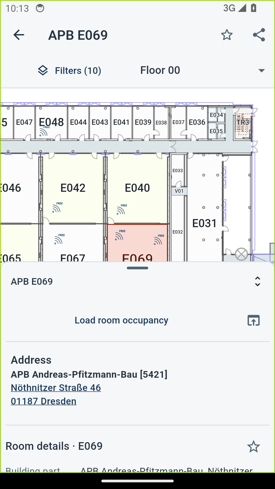
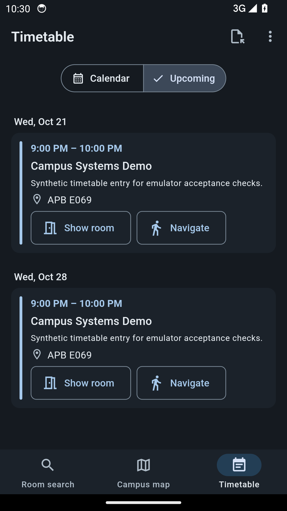

# Campus Navigator

**Räume finden und sich auf dem Campus der TU Dresden orientieren.**

[Deutsch](#deutsch) · [English](#english) · [Campus Navigator öffnen](https://navigator.tu-dresden.de/)

Campus Navigator ist eine Flutter-App für die mobile Nutzung des TU-Campusnavigators. Sie verbindet Raum- und Gebäudesuche mit interaktiven Etagenplänen, einer Campuskarte, erweiterten Raumdetails und einem importierbaren Stundenplan.

## Deutsch

### Einblicke

<p align="center">
  <a href="docs/release-candidate-evidence/android14-home.png"></a>
  <a href="docs/release-candidate-evidence/android14-campus-map.png"></a>
  <a href="docs/release-candidate-evidence/android14-room-details.png"></a>
  <a href="docs/release-candidate-evidence/android14-timetable-upcoming.png"></a>
</p>

### Funktionen

- **Räume und Gebäude suchen:** Treffer öffnen den passenden Raum oder das Gebäude.
- **Favoriten und Verlauf:** Räume und Gebäude speichern und zuletzt geöffnete Räume wiederfinden. Die Listen bleiben lokal auf dem Gerät.
- **Campuskarte:** Gebäude auf der OpenStreetMap-Karte suchen und auswählen, Karte verschieben und zoomen sowie zwischen hellem und dunklem Kartenstil wechseln.
- **Etagenpläne:** verfügbare Stockwerke ansehen, den Plan verschieben und vergrößern und Räume oder Ausstattung hervorheben.
- **Gebäudeinformationen:** Adressen ansehen und in einer Karten-App öffnen.
- **Raumdetails:** zusätzliche Angaben wie Sitzplatzzahl und verbundene Raumzugänge anzeigen.
- **Fußgängernavigation:** eine Route in Google Maps zum Gebäudepunkt starten. Der Punkt ist kein bestätigter Gebäudeeingang.
- **Raumbelegungspläne:** Belegungsinformationen mit Universitätszugang laden.
- **Stundenplan:** ICS-Dateien mit wiederkehrenden Terminen importieren, die nächste Veranstaltung anzeigen und bekannte Räume direkt öffnen.
- **Freiraumsuche:** verfügbar, in der App derzeit noch als WIP gekennzeichnet.
- **Einstellungen:** App- und Kartenfarbmodus, Sprache, Cache-Dauer, Vorladen von Suchtreffern, Planqualität und gespeicherte Zugangsdaten verwalten.
- **Zwischenspeicher:** zuvor geladene Karten- und Gebäudedaten können bei erneuten Aufrufen helfen. Die App bietet keinen vollständigen Offlinekartenmodus.

Die App nutzt öffentliche Daten des [TU-Campusnavigators](https://navigator.tu-dresden.de/) und Kartenkacheln von OpenStreetMap. Für die Standortanzeige wird der Gerätestandort erst nach ausdrücklicher Auswahl der Standortfunktion angefragt. Die Fußgängernavigation übergibt das Gebäudeziel an Google Maps.

### Voraussetzungen

- Flutter 3.24.5 mit Dart 3.5 oder eine kompatible Flutter-Installation
- Für Android-Builds: Android SDK und JDK 17

Die im lokalen Projekt verwendete Toolchain und Einrichtung sind in [docs/development-environment.md](docs/development-environment.md) beschrieben.

### Starten

```bash
flutter pub get
flutter run
```

### Android-Build

```bash
flutter build apk --release
```

Die APK liegt anschließend unter `build/app/outputs/flutter-apk/app-release.apk`.

### Projektziele

Campus Navigator soll die häufigsten Campus-Aufgaben auf dem Smartphone vereinfachen. Die App ergänzt den Webdienst um eine mobile Oberfläche; sie bildet nicht jede Funktion der Website nach.

---

## English

**Find rooms and get around the TU Dresden campus.**

Campus Navigator is a Flutter app for using the TU Dresden campus navigator on mobile. It brings room and building search together with interactive floor plans, a campus map, expanded room details, and an importable timetable.

### Screenshots

<p align="center">
  <a href="docs/release-candidate-evidence/android14-home.png"></a>
  <a href="docs/release-candidate-evidence/android14-campus-map.png"></a>
  <a href="docs/release-candidate-evidence/android14-room-details.png"></a>
  <a href="docs/release-candidate-evidence/android14-timetable-upcoming.png"></a>
</p>

### Features

- **Search rooms and buildings:** open a matching room or building from the results.
- **Favorites and history:** save rooms and buildings and revisit recently opened rooms. Lists are stored locally on the device.
- **Campus map:** find and select buildings on an OpenStreetMap basemap, pan and zoom, and switch between light and dark map styles.
- **Floor plans:** browse available floors, pan and zoom plans, and highlight rooms or facilities.
- **Building details:** view addresses and open them in a map app.
- **Room details:** view additional information such as seating capacity and connected room entrances.
- **Walking directions:** open Google Maps with the building map point as the destination. This point is not a verified building entrance.
- **Room occupancy plans:** load occupancy information with university credentials.
- **Timetable:** import ICS files with recurring events, see the next class, and open recognized rooms directly.
- **Free-room search:** available, but still marked WIP in the app.
- **Settings:** manage app and map themes, language, cache duration, search-result prefetching, plan quality, and saved credentials.
- **Cached data:** previously loaded map and building data can help on later visits. The app does not provide a full offline map mode.

The app uses public data from the [TU Dresden campus navigator](https://navigator.tu-dresden.de/) and OpenStreetMap tiles. Device location is requested only when the user selects the location feature. Walking directions pass the building destination to Google Maps.

### Requirements

- Flutter 3.24.5 with Dart 3.5 or a compatible Flutter installation
- Android SDK and JDK 17 for Android builds

See [docs/development-environment.md](docs/development-environment.md) for the toolchain and local setup used by this project.

### Run

```bash
flutter pub get
flutter run
```

### Build for Android

```bash
flutter build apk --release
```

The APK is written to `build/app/outputs/flutter-apk/app-release.apk`.

### Project goals

Campus Navigator focuses on common campus tasks on a phone. It adds a mobile interface to the web service and does not aim to reproduce every feature of the website.
